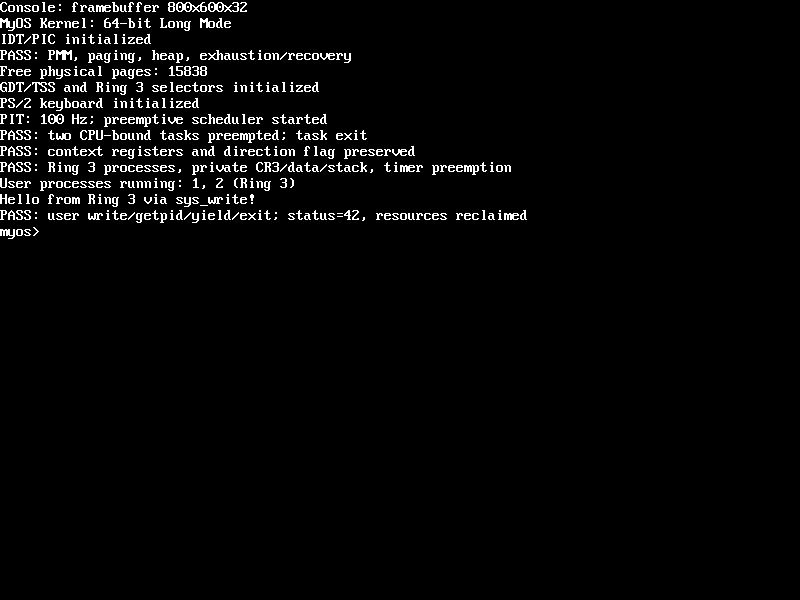

# Phase 10 — System Calls

User programs now request services through a dedicated **INT 0x80** gate.
This is a MyOS ABI, not the Linux ABI and not the x86-64 SYSCALL instruction.
The existing TSS/interrupt path provides a kernel stack and full saved register
frame, and IRETQ returns to Ring 3 after completing a request.

## ABI

- RAX contains the syscall number and then the signed 64-bit return value.
- RDI, RSI and RDX are argument registers (RDX is reserved for these first calls).
- Other general registers and interrupted flags are preserved, including RCX,
  R11 and DF. The kernel executes with DF clear.
- Only a Ring 3 process may use this API. A Ring 0 caller receives `-1` (EPERM).
- Unknown syscall numbers return `-38` (ENOSYS).

| Number | Name | Arguments | Result |
|---|---|---|---|
| 1 | `sys_write` | RDI=buffer, RSI=byte count | Count, `-14` (EFAULT), or `-22` (EINVAL) |
| 2 | `sys_getpid` | None | Current PID |
| 3 | `sys_exit` | RDI=exit status (signed low 32 bits) | Does not return |
| 4 | `sys_yield` | None | 0 when scheduled again |

`sys_write` sends bytes to the kernel console/serial output. It has no file
descriptor yet. Requests over 256 bytes return EINVAL. Zero bytes return 0
without accessing the pointer. The complete buffer is validated and copied
before output, so a failed request never prints a prefix of the data.

The validator checks canonical lower addresses, overflow, Present and User bits
at every page-table level, and every page touched. Huge-page user mappings are
not supported. Only then does it copy through the kernel's physical direct map;
it never dereferences an unchecked user virtual pointer. Read-only code pages
are valid sources. Supervisor kernel pages and unmapped stack guards are not.

Exit records the status, makes the process a zombie and immediately schedules
another task. The current kernel stack is not freed while executing on it;
the kernel reaps it later using the Phase 9 process lifecycle. Yield keeps the
process runnable and saves its return frame before switching.

## Example user assembly

```asm
%include "user/syscall.inc"
mov eax, SYS_WRITE
mov rdi, message
mov esi, message_end - message
int 0x80

mov eax, SYS_EXIT
xor edi, edi
int 0x80
message: db 'Hello from Ring 3!', 10
message_end:
```

Normal boot starts a demo that calls getpid, prints
`Hello from Ring 3 via sys_write!`, yields, and exits with status 42. The kernel
checks its PID/status and reclaims its resources. The two earlier Ring 3 counter
processes remain running. `myos>` is still a keyboard echo prompt, not a shell.

## Testing

```bash
python3 tests/test_system.py --suite syscalls
python3 tests/test_system.py
```

Test builds execute 29 user-side result/register checks: getpid, unknown numbers,
kernel pointers, noncanonical/overflowing addresses, guard pages, a partially
valid buffer, oversized/empty writes, RX/RW cross-page reads, stack buffers,
and 16 yields. The host verifies exact output and confirms the `LEAK` prefix
from an invalid cross-page request was never printed. Kernel checks cover
Ring 0 rejection, positive and negative exit statuses, and resource reclamation.

The full suite passed on 2026-09-23 with 16/64/256 MiB RAM, framebuffer/VGA,
keyboard input, process isolation/fault cases and the existing kernel exception
tests. The harness restores the normal non-faulting image after variants.

## Current limits

Calls are short and bounded and execute with interrupts disabled on one CPU.
There is no blocking read, descriptor table, filesystem API, sleep/wait syscall,
or SMP-safe user-copy implementation yet. Applications are still embedded demos;
this is not a POSIX/Linux-compatible ABI or a security-audited kernel.


