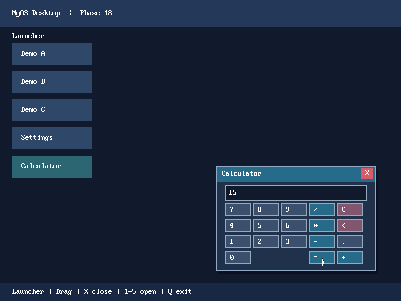

# Phase 18 — Calculator

Phase 18 adds a working Calculator window to the MyOS framebuffer desktop.
It supports digit and decimal entry, addition, subtraction, multiplication,
division, equals, Clear and Backspace by PS/2 keyboard or mouse. The
Calculator is a kernel-resident GUI module, **not** an isolated user process.



## Try it

```bash
cd ~/myos
python3 tools/run_logged.py -- bash build.sh
qemu-system-x86_64 -m 64M \
  -drive format=raw,file=build/myos-current.img,if=floppy -boot order=a
```

At `myos>`, type `desktop`. Click the **Calculator** launcher tile or press
**5** while the desktop has focus. Its keypad and the keyboard accept
`0`–`9`, `.`, `+`, `-`, `*`, `/`, `=` and Enter. Press **C** to clear the whole
calculation or Backspace to erase the last input digit. For example, enter
`2.5+1.25=` to get `3.75`; then `*2=` to get `7.5`.

The active Calculator consumes digit keys, so the `1`–`5` desktop shortcuts
do not steal numeric input. Click a launcher tile to switch windows. Click
the window's **X** to close it; reopening starts at zero. Press **Q** or Esc
to leave the desktop. Settings and the Phase 16 demo windows remain usable.
The text-mode VGA fallback keeps the Shell, but cannot open the GUI desktop.

## Arithmetic and errors

Values use signed fixed-point thousandths, without kernel floating-point
instructions. The input and result range is -999999.999 through 999999.999;
entry accepts at most six digits before and three digits after the decimal.
Multiplication and division truncate toward zero at three decimal places,
so `1/3=` displays `0.333`. Exceeding the range shows `Error: overflow`.
Division by zero shows `Error: divide by zero`. A repeated decimal point,
overlong number, unsupported printable key or incomplete expression shows
`Error: invalid input`. **C** clears any error and starts a new calculation.
Calculator state lives in RAM and is reset when the window is reopened.

## Verification

```bash
cd ~/myos
python3 tools/run_logged.py -- python3 tests/test_system.py --suite calculator
python3 tools/run_logged.py -- python3 tests/test_system.py
```

The focused test sends real QEMU PS/2 key and mouse events, checks arithmetic,
chaining, input editing, each error and recovery, actual display pixels,
the 16 MiB case and VGA fallback. It writes screenshots to
`build/system-tests/calculator-framebuffer.ppm` and
`build/system-tests/calculator-error.ppm`. The full suite regresses earlier
phases and restores the normal framebuffer image. Development output is
visible with `tail -f build/activity.log`. The owner pushes commits manually.
