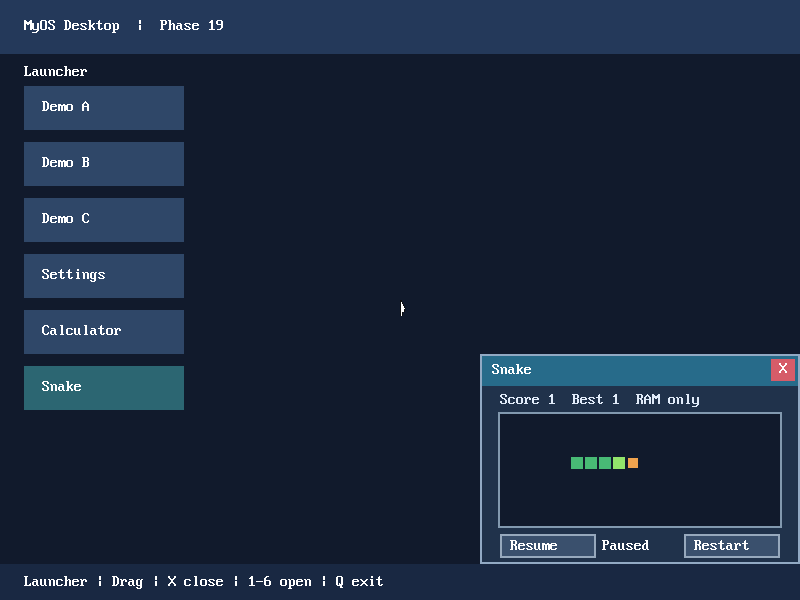

# Phase 19 — Snake

Phase 19 adds Snake to the MyOS framebuffer desktop. The game moves on the
100 Hz PIT clock at four cells per second. It has food, growth, score, wall
and body collision, pause and restart. Its high score is saved in the existing
Phase 13 RAMFS snapshot when a recognized ATA data disk is attached. Snake
is a **kernel-resident GUI module**, not an isolated user process.



## Try it

```bash
cd ~/myos
python3 tools/run_logged.py -- bash build.sh
qemu-system-x86_64 -m 64M \
  -drive format=raw,file=build/myos-current.img,if=floppy \
  -drive format=raw,file=build/myos-data.img,if=ide,index=0 \
  -boot order=a
```

Create the data image once with `python3 tools/create_data_disk.py` if it does
not already exist. Reuse that same image on later boots; the creation command
refuses to overwrite one. Omit the data-disk drive if you only want a
temporary high score.

At `myos>`, enter `desktop`, then click **Snake** in the launcher or press
**6**. The arrow keys or **W/A/S/D** steer. Press **P** or Space to pause and
resume; **R** restarts after a collision. You can also click the **Pause** and
**Restart** buttons. The snake cannot reverse directly into itself. Food
increases its length and score. The header shows Score, Best and whether Best
is stored on disk or remains in RAM. Click another window to use it while
Snake keeps moving; click Snake again to steer. Press **Q** or Esc to leave
the desktop. The VGA text fallback retains the Shell, not the GUI game.

The high score record is a 12-byte versioned, checksummed file at
`/home/snake.score`. Invalid file type, size, version, score or checksum is
rejected and Best starts at zero. The checksum detects accidental corruption,
not tampering. If a disk save fails, the current score remains in RAM and
the game shows **Save failed**; it may not survive reboot. Without a data
disk, the high score stays available for the current boot only.

## Verification

```bash
cd ~/myos
python3 tools/run_logged.py -- python3 tests/test_system.py --suite snake
python3 tools/run_logged.py -- python3 tests/test_system.py
```

The QEMU test sends actual PS/2 arrow keys, letters and mouse events; checks
timer movement, pause, restart, growth, collision and rendering; keeps
Calculator responsive while Snake runs; checks 16 MiB RAM and VGA fallback;
and verifies a saved high score across reboot plus invalid-file recovery.
Screenshots and serial logs are in `build/system-tests/`. The complete suite
regresses earlier phases and restores the normal framebuffer image. Commands
and results are visible with `tail -f build/activity.log`. The owner pushes
commits manually.
