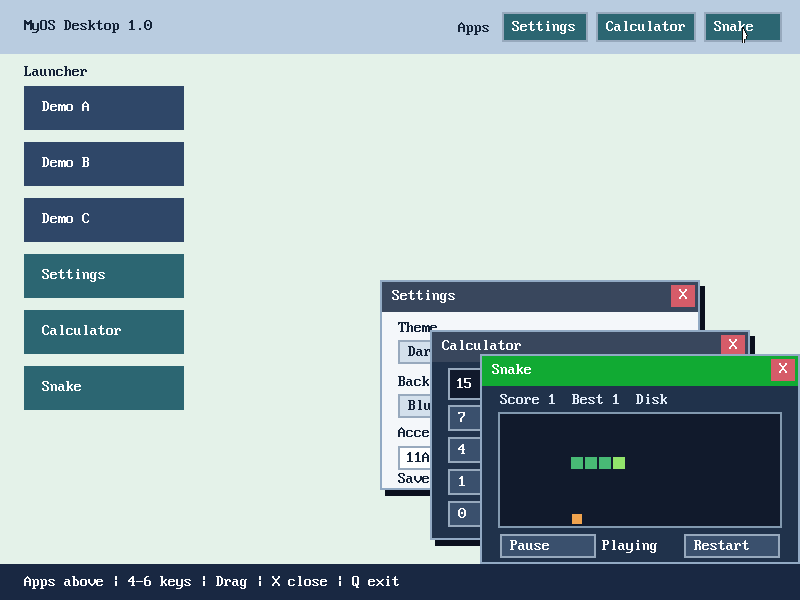

# Phase 20 — MyOS Desktop 1.0 QEMU demo

Desktop 1.0 brings the three working built-in apps together. The top bar
opens **Settings**, **Calculator** and **Snake** directly; the launcher keeps
the three earlier window demos for development. The apps run **inside the
kernel**, not as isolated user processes. This is a QEMU desktop milestone,
not a bootable USB or a real-hardware release.



## Repeatable demo

From the MyOS repository in WSL Ubuntu:

```bash
cd ~/myos
python3 tools/desktop_demo.py
```

The script checks or creates `build/myos-demo-data.img`, builds the normal
framebuffer boot image, and opens QEMU with 64 MiB RAM and that dedicated ATA
data disk. It **never overwrites an existing data image**. Later runs reuse
it, so Settings and Snake's best score survive reboot. The existing file
must have the MyOS data signature and a valid sector-aligned size. To build
and check the demo without opening QEMU, run:

```bash
python3 tools/desktop_demo.py --prepare-only
```

For a separate save file, pass `--data build/another-demo.img`. The build and
QEMU commands are recorded in `build/activity.log`; watch them from another
terminal with `tail -f build/activity.log`. Close the QEMU window to end the
session. The floppy image is rebuilt; the data image is preserved.

At `myos>`, enter `desktop`. Click an app in the top bar, or press 4 for
Settings, 5 for Calculator and 6 for Snake. The lower launcher also opens
these apps; Demo A/B/C are retained as windowing exercises. Drag a title bar
to move a window, click another window to focus it, and click **X** to close.
Press **Q** or Esc to leave the desktop and return to the Shell.

- **Settings:** choose dark/light theme, blue/green background and six-digit
  RGB accent. Click **Save**. The status line reports disk or RAM-only save.
- **Calculator:** type or click digits and `+ - * / . =`; Enter also evaluates.
  Press C to clear or Backspace to edit. `8/0=` displays an error; C recovers.
- **Snake:** steer with arrows or W/A/S/D. P or Space pauses; R restarts after
  collision. The game keeps moving while another window has focus. The top
  line shows score, best score and storage state.

After closing the desktop, `settings`, `cat /etc/motd`, `ls /home`, `disk` and
other Shell commands remain available. Reopen `desktop` to resume with saved
Settings and best score. If you do not attach a recognized MyOS data disk,
changes remain in RAM until reboot. The VGA text fallback retains the Shell
but cannot show the desktop.

## Acceptance and limits

```bash
cd ~/myos
python3 tools/run_logged.py -- python3 tests/test_demo_package.py
python3 tools/run_logged.py -- python3 tests/test_system.py --suite release
python3 tools/run_logged.py -- python3 tests/test_system.py
```

The integration test opens all three apps in one QEMU session, rejects an
invalid Settings color, recovers from Calculator division by zero and Snake
collision, checks the Shell, reboots with the same data image and verifies
both restored preferences and high score. It also tests all three windows
together at 16 MiB RAM and the VGA fallback. Screenshots and serial logs
are in `build/system-tests/`; the full suite restores the normal framebuffer
image. The owner pushes commits to GitHub manually.

Desktop 1.0 uses BIOS boot, QEMU VBE graphics, PS/2 input and the custom
Phase 13 ATA snapshot format. It has no USB/UEFI, general executable app
loader, web browser, networking, audio or video. Later phases address those
separately; this milestone does not imply YouTube support.
