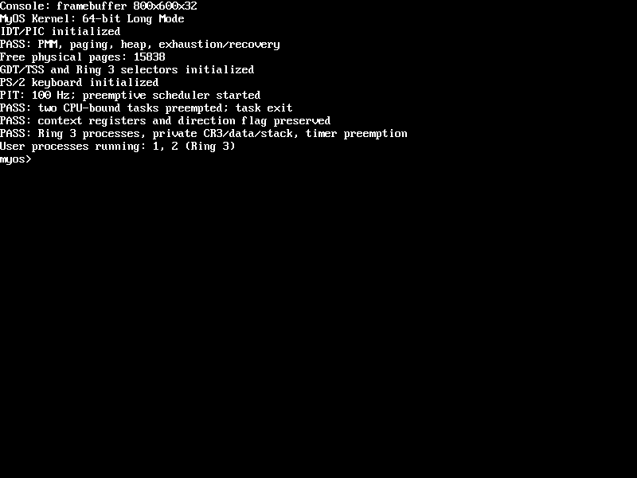

# Phase 9 — Process / User Mode

This records the Phase 9 milestone. The subsequent syscall ABI is documented in
[PHASE10.md](PHASE10.md).

The kernel can now create and preempt **Ring 3 processes**. Normal boot starts
two embedded demo programs with different PIDs, address-space roots and physical
memory, then returns to the existing keyboard echo console.

## Implementation

- A kernel-owned GDT adds user code/data selectors (0x2b / 0x23) and a 64-bit
  TSS. RSP0 points to the selected process's 16 KiB kernel stack before returning
  to Ring 3. Port I/O is denied by IOPL=0 and an out-of-limit TSS I/O map.
- Each process owns seven physical pages: PML4, PDPT, PD, PT, code, data, stack.
  User mappings occupy PML4 slot 1. Shared kernel mappings in slot 0 remain
  supervisor-only. CR3 switches together with the saved interrupt frame.
- Virtual addresses are identical across programs, but physical pages differ:
  code at 0x8000000000 (RX), data at 0x8000001000 (RW/NX), guard at
  0x8000002000 (absent), stack at 0x8000003000 (RW/NX).
- IRQ/exception entry installs kernel data selectors; IRETQ restores the target
  privilege level, flags and stack. Timer interrupts prove return from Ring 3.
- User exceptions make only the current process a zombie. Kernel exceptions,
  NMI, double fault and machine check remain fatal. Reaping is deferred until
  running on another stack/address space, then frees all owned pages and the
  kernel stack. Slots can be reused; PIDs increase rather than immediately reuse.
- There are four kernel-task slots and four process slots. Ring 3 demos have
  counters and private cookies; they do not print through unimplemented syscalls.

## Test coverage

```bash
python3 tests/test_system.py --suite processes
python3 tests/test_system.py
```

Test builds use `PROCESS_TESTS=1`; normal builds use 0. The harness restores a
normal build afterward, so intentional user-fault probes do not run in the
normal UI. Tests verify actual CS=0x2b, stack push/pop in user memory, distinct
CR3 and backing pages at identical virtual addresses, timer preemption, process
capacity, stale PID rejection, 16 create/kill/reap cycles, and page counts.
Allocation-failure tests exhaust physical pages and heap space separately and
verify that partially allocated process resources are reclaimed.

Thirteen user-fault probes verify both exception/error codes and CR2 for page
faults, and confirm another process continues running:

| Probe | Expected exception / error |
|---|---|
| Read kernel code | #PF / 0x05 |
| Write kernel code | #PF / 0x07 |
| CLI | #GP / 0 |
| Port I/O | #GP / 0 |
| Write user RX code | #PF / 0x07 |
| Execute user NX stack | #PF / 0x15 |
| Read stack guard | #PF / 0x04 |
| UD2 | #UD / 0 |
| INT 0x20 into a kernel-only gate | #GP / 0x102 |
| Read kernel heap | #PF / 0x05 |
| Read CR3 | #GP / 0 |
| Execute kernel code | #PF / 0x15 |
| Unsupported x87 instruction | #NM / 0 |

## Limits and next phase

This is an educational QEMU implementation, not a security-audited sandbox.
The loader embeds one small assembly demo image; there is no ELF executable
loader, filesystem, fork, user-space allocator, IPC, shell launcher, or system
call ABI yet. Process kill/reap are kernel APIs. Normal user exit and controlled
console access are planned for Phase 10 (system calls).

FPU/SIMD and TLS are unsupported. CR0.TS blocks x87 use rather than sharing
unsaved floating-point state; the kernel uses general registers only. Processes
have one-page user stacks with a guard; kernel stacks do not yet have guards or
a dedicated double-fault stack. The system is single-CPU.

## Validation on 2026-09-23

The full suite passed at 16/64/256 MiB, with framebuffer and VGA keyboard tests,
all process probes, and the existing fatal kernel-exception tests. The kernel
#GP probe now uses selector 0x48 because 0x28 became a valid user-code descriptor.
The restored normal boot also reached `myos>` with two live Ring 3 processes.



## Phase 33.1 continuation (2026-09-28)

The historical x87 limitation above is superseded by per-task FXSAVE64 /
FXRSTOR64 context switching. The 13th live fault probe now checks disabled
AVX (#UD), not x87 (#NM). TLS remains unsupported. See PHASE331_FP.md.
