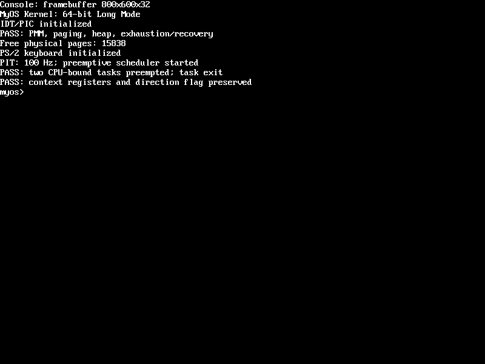

# Phase 1–8 baseline validation — 2026-09-23

Environment: WSL Ubuntu, GCC/NASM/binutils, qemu-system-x86_64 (TCG), BIOS boot.

Command: `python3 tests/test_system.py`

| Test | Result |
|---|---|
| Default 800x600x32 framebuffer boot at 64 MiB | PASS |
| 16 MiB and 256 MiB RAM boots | PASS |
| PMM allocation, exhaustion, free and recovery | PASS |
| Virtual map/translate/unmap; page-table reclamation | PASS |
| Heap alignment, boundaries, coalescing and OOM | PASS |
| Two non-yielding tasks make sustained progress | PASS |
| Integer-register and direction-flag context checks | PASS |
| Task exit and capacity limit | PASS |
| Actual PS/2 input: Shift/Caps Lock/Backspace/Enter | PASS |
| Extended-key filtering, framebuffer/VGA scrolling | PASS |
| #UD: error 0 and exact fault RIP | PASS |
| #GP: invalid selector 0x28 and exact fault RIP | PASS |
| #PF: missing page, error 0x02, correct CR2 | PASS |
| #PF: read-only write, error 0x03, correct CR2 | PASS |
| #PF: NX execution, error 0x11, correct CR2 | PASS |
| VGA fallback boot and keyboard | PASS |
| Normal image restored after all test variants | PASS |

ELF checks: ELF64, AMD x86-64, entry 0x10000, separate RX/RW LOAD segments.
No real-hardware or USB boot tests were performed. Resource limits and remaining
features are documented in README and ROADMAP.

